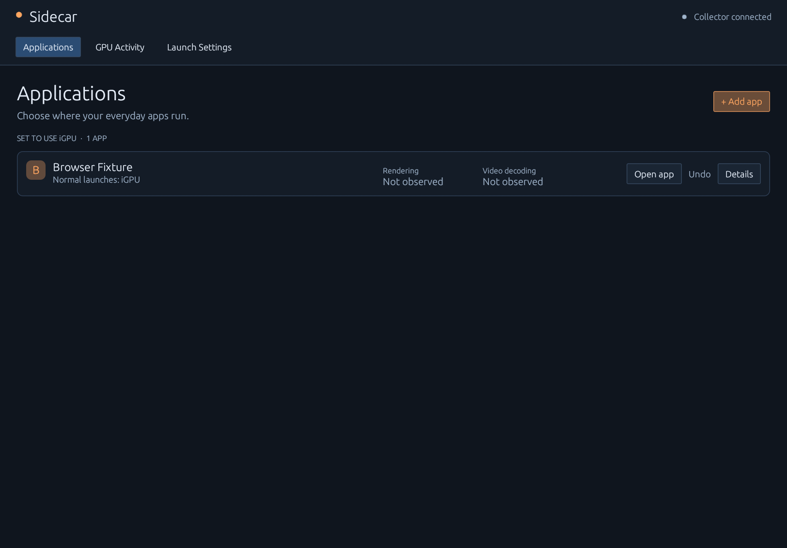

# Sidecar

**Put everyday apps on your iGPU. See whether they actually use it.**

[Documentation](docs/README.md) · [Issues](https://github.com/EntropicTech/Sidecar/issues) · [CI](https://github.com/EntropicTech/Sidecar/actions) · [Changelog](CHANGELOG.md)

Sidecar helps native Linux desktop apps prefer the integrated GPU when you open
them normally, leaving your discrete GPU available for games and other work.
It shows rendering and video decoding separately so you can verify the result.

The current target is **CachyOS / Arch Linux, KDE Plasma Wayland, and AMD iGPU +
dGPU systems**. This is an early project; broader compatibility and performance
benefits need validation. There is no claimed AUR or CachyOS repository package yet.



## Use it

1. Open **Applications → Add app** and find an installed app.
2. Choose **Use iGPU**, review the change, and confirm.
3. Open the app with its usual shortcut. If it is already running, close and
   reopen it when ready. Watch the separate **Rendering** and **Video decoding**
   observations; play a video to check decoder activity.
4. Use **Undo** to restore its previous launcher.

Your routing survives a reboot. Sidecar preserves the original launcher identity
and uses a reversible per-user override. It does not start managed apps at login,
change session restoration, terminate apps, or migrate running workloads.
Direct executable commands and some restored sessions can bypass a desktop launcher.

Use **Managed elsewhere** for apps configured by another workflow. The dashboard
has three tabs:

| Tab | Purpose |
| --- | --- |
| Applications | Add apps, use the iGPU, observe placement, and undo routing |
| GPU Activity | Paired GPU graphs, connected monitors, and collection health |
| Launch Settings | Custom explicit launch profiles and separate shortcuts |

Close keeps Sidecar in the system tray and stops dashboard rendering/polling.
Click its icon to reopen. **Quit Sidecar** fully exits the dashboard and tray;
the collector continues independently. [Everyday use and verification](docs/user-guide.md)
explains evidence states, Firefox behavior, graph scaling, and routing limits.

## Build and install

You need Rust **1.89+**, Python **3.11+**, native graphics libraries, and a session
D-Bus connection. Follow the [setup guide](docs/setup.md) for CachyOS/Arch
prerequisites, a source-only trial, and package installation.

For a first per-user installation, from a checkout with the prerequisites installed:

```sh
git clone https://github.com/EntropicTech/Sidecar.git
cd Sidecar
make build
make PREFIX="$HOME/.local" USER_UNIT_DIR="$HOME/.local/share/systemd/user" install
systemctl --user daemon-reload
systemctl --user start igpu-man.service
"$HOME/.local/bin/igpu-man-desktop"
```

Installed files work independently of the checkout. Technical binaries, service
names, package name and data directories remain `igpu-man` for compatibility.
**Sidecar's own tray startup is optional**, separate from routing your apps; see
[login setup](docs/setup.md#optional-sidecar-startup).

For later updates to an active developer installation, save edits, close Sidecar
to the tray, and run:

```sh
make update-user
```

The updater checks/tests/builds, refuses active recordings and visible dashboards,
backs up data privately, preserves routing/startup, and restores programs on
failure. Pacman installations use package updates. See [updates and recovery](docs/updates-and-releases.md).
Before uninstalling, **undo managed routes** so shortcuts no longer depend on
Sidecar's wrapper; follow [removal instructions](docs/setup.md#uninstall).

## What the evidence means

- A GPU device being open is not proof of rendering or decoding. Missing,
  permission-denied, stale, warming-up and idle readings are distinct.
- Rendering and video decoding can use different GPUs. Missing decoder activity
  alone does not prove software decoding. Native Firefox is the initial browser
  target; Flatpak routing and other browsers need separate work/validation.
- GPU identities use PCI addresses, not changing `cardN` numbers. Accounting covers
  accessible processes owned by the current user; shared client memory is not
  additive physical GPU memory.
- Cross-GPU transfers are not directly measured. Lower dGPU activity is not proof
  of better game frametimes; optional [CLI experiments](docs/experiments.md)
  support repeatable comparisons.

Normal sampling is once per second; recording uses 250 ms. History, queues and
worker concurrency are bounded, and idle workers sleep. See [measured overhead
and validation limits](docs/validation.md#current-acceptance-summary).

## Privacy and troubleshooting

Everything stays local. Sidecar has no upload service or root helper and does not
collect browsing history, page contents, complete process arguments/environments,
or raw application output. Explicit profile settings and optional recordings are
local data; review exports before sharing. The collector's documented
[service sandbox tradeoff](docs/security.md#user-service-procfs-compatibility)
preserves per-application GPU accounting.

```sh
igpu-man doctor
igpu-man status --json
igpu-man-desktop --status
igpu-man logs --component desktop --lines 100
```

Start with [troubleshooting](docs/troubleshooting.md) for stale data, launcher
conflicts, Firefox verification, Close/reopen problems and interrupted updates.
Report a minimal, reviewed reproduction in [Issues](https://github.com/EntropicTech/Sidecar/issues);
use [private reporting guidance](SECURITY.md) for security concerns.

## Development

```sh
make check
make test
```

Read [CONTRIBUTING.md](CONTRIBUTING.md), [AGENTS.md](AGENTS.md), and the
[engineering standards](docs/engineering-standards.md) before changing behavior.
Checks cover Rust formatting, all-feature Clippy, documentation contracts, Python
syntax, unit tests and isolated D-Bus integration. Native lifecycle, packaging,
advisory and hardware checks have their own instructions and evidence.

The [documentation index](docs/README.md) links the CLI/API references,
architecture, security policy and outstanding review work. Sidecar is
[MIT licensed](LICENSE); bundled eframe compatibility sources include their own
[licenses and provenance](vendor/README.md).
