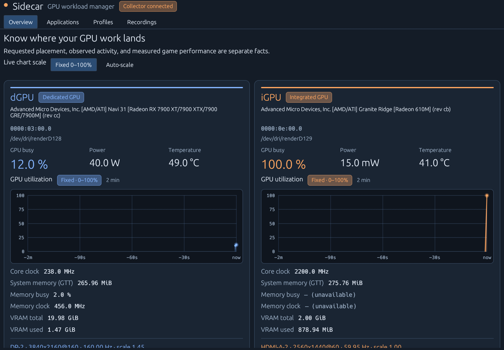

# Sidecar

[Source and issues](https://github.com/EntropicTech/Sidecar) · [CI](https://github.com/EntropicTech/Sidecar/actions)

Sidecar is a Rust GPU workload manager for CachyOS / Plasma Wayland and AMD iGPU + dGPU
desktops. Launch side applications on an explicit GPU, verify observed engine
activity, and compare game frame consistency using local recordings.

The monitor's cable, an application's renderer, its video decoder, and KWin's
compositor can involve different GPUs. igpu-man keeps requested placement,
observed activity, and measured performance separate.



Orange identifies the iGPU; blue identifies the dGPU throughout the dashboard.
Warnings use amber, errors use coral, and recording markers use purple, with text
labels alongside the colors. Live utilization charts default to **Fixed 0–100%**;
the **Auto-scale** control in Overview fits each GPU's axis to its visible
two-minute history with modest headroom and a minimum 0–1% range. Every chart
labels its current range; compare actual percentages when the axes differ.
Switching modes changes only the axes, not the readings or recordings. The choice
lasts for the dashboard session; a fresh launch defaults to fixed scale.
Charts include thin traces, shaded areas, grid lines, current-sample dots and hover
readings. Missing history is left empty rather than interpolated across long gaps.
[Auto-scale preview](docs/images/dashboard-auto.png).

Sidecar uses the paired blue/orange icon in its window, system tray, and app
launcher. Technical commands, D-Bus names, service names and XDG directories remain
`igpu-man` for compatibility. Close keeps Sidecar in the tray; click its icon to reopen.
**Quit Sidecar** exits the dashboard and tray while the collector keeps monitoring. The icon is static and decoded once at startup.

## Build and try it

Install Rust/Cargo, coreutils (source/artifact hashing), and native development libraries using your normal package
manager. On CachyOS/Arch the build packages are `base-devel rust cargo pkgconf
wayland libxkbcommon libxkbcommon-x11 libglvnd libx11 libxcb fontconfig python`. The current locked
dependencies require Rust 1.89 or newer. MangoHud is optional.

```sh
cargo build --workspace --release --locked
# In one terminal inside your Plasma session:
./target/release/igpu-mand
# In another:
./target/release/igpu-man status
./target/release/igpu-man-desktop
```

The collector runs without root. No GPU settings are changed by monitoring.
Software-version probes are cached for five minutes and invalidated when the
resolved executable or Arch package-database metadata changes (checked every 30
seconds). KWin/display diagnostics retain their separate 30-second refresh; GPU
sensors and hardware/connector discovery keep their normal sampling cadence.

Low overhead is a project requirement: one-second normal sampling, bounded shared
history, sleeping workers, and isolated recording I/O. Current release measurements
and their limits are in [validation](docs/validation.md#recording-isolation-and-remaining-review--november-1-2026).
Closing the window keeps **Sidecar in the system tray**. Click the icon or choose
**Open dashboard** to reopen it. Charts and dashboard polling stop while closed;
the selected view and drafts are preserved. The parked telemetry worker blocks
on events; it has no periodic wake-up timer. **Quit Sidecar** exits the dashboard
and tray; the collector, recordings and launched applications continue independently.
If no system tray is available, closing exits the dashboard. Relaunching reuses
an existing resident instance.
`igpu-man-desktop --status`, `--close`, and `--quit` support diagnosis and control
without opening another window. Window activation follows Plasma's focus policy.

To install with pacman, run `make dist`, enter `dist`, inspect `PKGBUILD`, and run
`makepkg -si`. The source is a local archive, not a placeholder remote repository.
The generated PKGBUILD is pinned to the archive checksum and includes `.SRCINFO`. Alternatively, after building, install with `sudo make install`.

```sh
systemctl --user daemon-reload
systemctl --user start igpu-man.service
# Optional collector login autostart:
systemctl --user enable igpu-man.service
# Optional Sidecar tray login autostart (no window):
mkdir -p "${XDG_CONFIG_HOME:-$HOME/.config}/autostart"
cp /usr/share/doc/igpu-man/igpu-man-autostart.desktop "${XDG_CONFIG_HOME:-$HOME/.config}/autostart/igpu-man.desktop"
```

A per-user install needs no administrator access and is independent of the source
folder once installed:

```sh
make build
make PREFIX="$HOME/.local" USER_UNIT_DIR="$HOME/.local/share/systemd/user" install
systemctl --user daemon-reload
systemctl --user enable --now igpu-man.service
mkdir -p "${XDG_CONFIG_HOME:-$HOME/.config}/autostart"
cp "$HOME/.local/share/doc/igpu-man/igpu-man-autostart.desktop" "${XDG_CONFIG_HOME:-$HOME/.config}/autostart/igpu-man.desktop"
"$HOME/.local/bin/igpu-man-desktop" --tray
```

The installer renders absolute binary paths in the launcher, autostart template
and unit. The user systemd directory above is in the standard search path. Remove
an old checkout-specific `~/.config/systemd/user/igpu-man.service` override and
replace any old checkout launcher/autostart entries after backing them up; their
higher priority can otherwise keep pointing at the checkout. Re-enable the unit
after removing an old enablement symlink. For a running collector, preserve live
registrations and do not restart during an active recording.

For subsequent changes, save editor drafts, close Sidecar to the tray and run
`make update-user`. It checks/tests/builds, refuses active recordings, backs up
saved data, stages an atomic installed-file update, restarts with live launch
registrations restored, and rolls programs back on failure. Autostart and service
enablement are preserved. `make recover-user RUN=/path/to/transaction` handles
interrupted deployments. See [updates and releases](docs/updates-and-releases.md)
for backup retention, lease/schema limits and the AUR/CachyOS release path.
It is a user installation, not a pacman-managed package. System-wide pacman
installation remains available using the PKGBUILD above.

The service respects XDG locations inherited from the systemd user manager,
falling back to `$HOME/.config` and `$HOME/.local/share`. For custom locations not
already present in the manager environment, set them in a user-service override.
The application creates its directories; autostart remains opt-in. `--tray` creates
no native window/graphics context until you activate the icon. A duplicate
`--tray` invocation leaves an existing instance unchanged. Startup allows 15
seconds for Plasma's tray to appear, then opens a fallback window if unavailable.
Tray commands and Quit work before the first window is ever opened.

For a source checkout, use an absolute release-binary path in both Exec and TryExec
of the autostart entry, and an absolute collector path in a user-service unit at
`$XDG_CONFIG_HOME/systemd/user/igpu-man.service` (default `~/.config`). Keep the
checkout available at login. Packaging installs the opt-in template, never enables
login startup automatically. Disable the tray entry in Plasma Autostart or remove
`$XDG_CONFIG_HOME/autostart/igpu-man.desktop`; disable the collector separately with
`systemctl --user disable igpu-man.service`.

See the [documentation index](docs/README.md), [troubleshooting guide](docs/troubleshooting.md),
[architecture](docs/architecture.md), and [engineering review](docs/code-review.md).

## Find, try, verify, and keep applications

Open **Applications** in the dashboard (or run `igpu-man-desktop --applications`).
The candidate list ranks sustained dGPU activity over the collector's last minute,
even if the dashboard was closed. Graphics, video, other engines, and observation
coverage are shown separately. Idle device handles do not make an application an
active candidate; inaccessible accounting remains unknown. Engine percentages are
client busy time, not additive whole-device utilization or predicted FPS gains.

1. Choose **Try on iGPU** on a running app, or **Add installed application…** to
   search installed launchers. Matching desktop entries prefill launch settings;
   a manual fallback is available if no launcher matches.
2. Review the launch settings, close the old application normally, and choose
   **Launch test**. No profile is saved yet and no running application is killed.
3. Use the application. Rendering and video decoding are verified independently;
   play a video to test decoding. Verification requires at least three active
   samples spanning two seconds from the new launch, using PID/start-time and
   descendant tracking. Startup probes and reused instances cannot establish
   success. Missing decoder activity alone does not prove software decoding.
4. Choose **Keep profile** after sustained target-GPU activity is verified. Keep
   saves the settings and verification summary, and optionally creates a separate
   Plasma launcher. Pin that launcher for future launches. Existing launchers and
   profile names are preserved. **Discard setup** leaves the test app running.

Each application now shows its **launch path** separately from observed GPU
activity. Expand **Launch path / next launch** for registered profile, test or
command evidence, available profiles, copyable launch commands and an **Open
Profiles** shortcut. Registration follows observed descendants using PID/start
identity even after a launcher exits. Multiple matching profiles remain explicit
alternatives; Sidecar does not guess your intended GPU.

**Unregistered launch** means this collector has no registration, not that a
particular pinned shortcut, menu entry or session restore bypassed a profile.
Manual collector restarts can lose registrations. Close an existing instance
normally before using a selected profile; single-instance applications can reuse
old GPU settings. Original launchers and other workflows are preserved.

Choose **Managed elsewhere** for applications configured by another workflow.
The exclusion is saved by executable identity and survives application/collector
restarts. **Undo** is available in the Managed elsewhere section, including when
the app is no longer running. KWin, Xwayland, and desktop infrastructure are shown
separately and excluded from application routing tests. A saved profile doing work
on another GPU is marked as a placement mismatch.

Installed launchers follow XDG precedence, including Hidden overrides. Import
preserves argv without shell evaluation, simple `env NAME=value` assignments,
working directories, icons, MIME types and file/URL argument positions. Generated
launchers pass files/URLs through `igpu-man launch PROFILE -- ...`. Terminal,
shell-wrapper, and sandbox launchers with unsupported semantics are labelled with
an explanation; desktop action submenus are not imported. Originals are untouched.
Explicit GPU selection takes precedence over GPU variables in an imported launcher.

CLI equivalents for discovery, import, and exclusions:

```sh
igpu-man candidates
igpu-man candidates --json
igpu-man candidates --all
igpu-man launchers
igpu-man profile import chat-side APPLICATION.desktop --gpu igpu
igpu-man profile launcher chat-side
igpu-man manage /absolute/path/to/emulator --elsewhere
igpu-man manage /absolute/path/to/emulator --restore
```

CLI profile import saves explicitly requested settings without claiming placement
verification; use the dashboard trial flow for verified Keep.

If the dashboard exits during a trial, reopen Applications and choose **Resume
verification** for its unkept launch. The collector retains the explicit settings
while the app/observed descendants remain alive. Resume fetches fresh evidence;
it never saves automatically. Unsaved editor changes are temporary. An uncoordinated collector restart loses live trial registrations. The coordinated
updater restores surviving launch identities, but verification evidence must be
gathered fresh after any collector restart.
[Recovery preview](docs/images/trial-recovery.png).

## Application profiles

```sh
igpu-man profile save browser-side --gpu igpu --firefox -- firefox
igpu-man profile save game-main --gpu dgpu -- /path/to/game
igpu-man profile list
igpu-man profile launcher browser-side
igpu-man launch browser-side
igpu-man run --gpu dgpu -- /path/to/game 'one argument with spaces'
igpu-man profile steam --gpu dgpu
```

Exit Firefox completely before changing its launch GPU. Existing browser
instances receive new-window requests using their original settings; igpu-man
detects Firefox-family processes and refuses that launch instead of terminating
them. Other single-instance applications may similarly reuse an existing
process: verify observed activity. Native Firefox is the initial supported
browser; custom forks need separate validation. Flatpak routing is deferred.

Profiles persist PCI addresses, not unstable `cardN` numbering. Default `igpu` /
`dgpu` aliases are inferred from VRAM size. If classification is incorrect or
ambiguous, select an explicit PCI address from `status`, or define aliases using
the example configuration in `data/config.example.toml` and restart the service.

Use `--vulkan-only` when a Vulkan application ignores the preferred device order.
This exposes only the chosen Vulkan device; it is an explicit compatibility
option, not a global setting. The Firefox adapter additionally sets
`MOZ_DRM_DEVICE` to the resolved render node. Verify rendering and decoding
individually; device preferences cannot guarantee all application internals.

## Record, mark, and compare

```sh
igpu-man record start browser-idle
igpu-man mark 'hitch while video started'
igpu-man record stop
igpu-man record list
igpu-man record notes 1 'Same scene, playback smooth, 1440p video'
igpu-man record import 1 /path/to/MangoHud.csv
igpu-man record show 1
igpu-man record compare 1 2 3
igpu-man record export 1 /path/to/new-bundle-directory
igpu-man experiment
```

Outside an active recording, `mark` saves the preceding two minutes of available
telemetry and the next 30 seconds. Repeated marks extend the capture. In Plasma
System Settings → Keyboard → Shortcuts, add an application/command shortcut for
`igpu-man mark`. No global keyboard hook is installed.

The dashboard includes an experiment schedule: browser idle, the same video on
the dGPU, and the same video on the iGPU, repeated three times in rotating order.
Each run defaults to 60 seconds of warm-up and 120 seconds of capture. The
schedule is guidance; the utility does not automate gameplay or media playback.
Use the same label for repetitions of a condition. Save video codec, resolution,
game settings, scene, and playback observations in the notes. See
[the experiment guide](docs/experiments.md).

For managed MangoHud capture:

```sh
igpu-man run --gpu dgpu --record --mangohud -- /path/to/game
# Stop telemetry and attach available frame logs when finished:
igpu-man record stop
```

MangoHud logs the first 120 seconds after its one-second startup delay. Temporary
raw logs live under `$XDG_RUNTIME_DIR/igpu-man`; selected logs are stored with the
recording on Stop. Telemetry can continue beyond the frame log. Missing MangoHud
does not affect normal monitoring or recordings. Install `lib32-mangohud` for
32-bit games. Gamescope uses `mangoapp` and is not supported by the managed
wrapper in this release; import its compatible logs separately.

Managed alignment is estimated from the first observed log contents and carries
polling uncertainty. External imports remain unaligned unless you supply
`--anchor-ns`, the collector's monotonic timestamp corresponding to elapsed zero
in that log; optionally supply `--uncertainty-ms`. Never align by file modification
time alone. Only aligned logs appear over telemetry in the timeline. `elapsed`
must be an increasing nanosecond column and `frametime` a positive millisecond
column. Original CSV files are retained.

## Trust and operating limits

- Metrics show sources and distinguish idle, unavailable, permission denied,
  warming up, and stale values. Device-open state is not measured engine work.
- Process coverage includes accessible processes owned by the current user.
  Existing GPU descriptors are sampled every tick; descriptor lists are
  rediscovered every five seconds. New processes are inspected on their first
  tick. An existing application opening a new GPU can take up to five seconds
  to appear.
  Shared DRM clients are counted once, assigned to a deterministic application
  group. Per-client memory can overlap across allocations and applications.
- CPU percentages use one core as 100%; a browser group can exceed 100%.
  Engine percentages measure busy time, not a share of GPU compute capacity.
- Missing video-engine activity does not prove software decoding. Browser
  playback drops are user observations in v0.1, not an automatic metric.
- Cross-GPU copies and their causes are not directly measured. Correlations with
  frame spikes are clues. No automatic tuning or performance-improvement claim.
- Power readings may omit CPU/system power. Do not call their sum wall power.
- No browsing history, page contents, full process arguments, or complete process
  environments are collected. Explicit profile arguments are saved as configured.
- No remote telemetry or automatic uploads. Exports can contain executable
  paths, explicit profile arguments/environment settings, hardware identifiers,
  and your notes. Review a bundle before sharing it.
- Telemetry persists only in selected recordings; private, bounded diagnostic logs
  also persist locally. The default database limit is 1 GiB of live
  pages with reserve space. At capacity, recording stops with a diagnostic;
  existing recordings are never automatically deleted. A stopped database may
  retain a small allocation/SQLite journal overhead. Delete recordings explicitly
  with `igpu-man record delete ID`.

Configuration: `$XDG_CONFIG_HOME/igpu-man/config.toml` (default `~/.config`).
Recording database: `$XDG_DATA_HOME/igpu-man/recordings.sqlite` (default
`~/.local/share`). Intervals, storage limit, threshold, and optional deduplicated
local notifications can be changed in the config; restart the service afterward.

## Diagnose a problem

```sh
igpu-man doctor
igpu-man status --json
igpu-man-desktop --status
igpu-man logs --component desktop --lines 100
igpu-man logs --component daemon --lines 100
```

Logs are structured JSON with stable events, timestamps, process identity, error
causes and request IDs. Match a failed CLI request's ID to `api.request_completed`
in the collector log. Files live in `$XDG_STATE_HOME/igpu-man/logs` (default
`~/.local/state/igpu-man/logs`), with private permissions, 5 MiB rotation, three
backups per file, and 32 retained inactive files plus active files. If logging to
disk fails, structured output falls back to stderr or the user service journal.
Payloads, browsing data, process environments and config excerpts are excluded.
See the [debugging runbook](docs/troubleshooting.md) and
[logging contract](docs/engineering-standards.md).

Collector calls have deadlines. A timeout does not establish whether a mutation
completed: inspect status before retrying. `igpu-man record stop --expected-id ID`
refuses to stop a different session and requires an updated collector. Application
launch cleanup uses the same guard. Keep the collector, CLI and dashboard updated
together; finish active recordings and Keep/discard trials before restarting it.

Recording reads, exports and CSV work run independently of live sampling and the
dashboard's telemetry worker. Queues/concurrency are bounded, and idle workers
sleep. Large exports/statistics stream telemetry. The dashboard loads a compact GPU-only
timeline and cached peak frame points; statistics/exports retain all data. Legacy
full timeline/frame arrays over 64 MiB return an explicit limit error; stopped raw
recordings also support cursor pages. Stop drains buffered samples
before confirming completion. SQLite WAL/free pages can add disk use beyond the
configured live-page budget. See [the architecture](docs/architecture.md).

## Tests and validation

```sh
make check
make test
# Separate native-window checks (temporary collector/data on a private bus):
dbus-run-session -- python3 tests/dashboard_lifecycle.py --cycles 8
igpu-man benchmark --seconds 30
igpu-man benchmark --seconds 30 --interval-ms 250
```

The integration suite uses a private session bus and temporary XDG locations.
It does not alter the installed service or GPU configuration. Hardware-dependent
profile checks run when AMD GPUs are accessible. See
[validation results and hardware checklist](docs/validation.md) and
[the local API](docs/api.md).

Read [CONTRIBUTING.md](CONTRIBUTING.md), [AGENTS.md](AGENTS.md) and the
[engineering standards](docs/engineering-standards.md) before changing behavior.
`make check` checks local documentation links, public CLI/API coverage, example
configuration, version consistency and documentation packaging alongside Rust
formatting and all-feature Clippy. CI also runs unit, private-bus integration and
software-rendered lifecycle tests; native GPU results remain separate.

## Uninstall

Remove/disable the Sidecar entry in Plasma Autostart (or remove
`$XDG_CONFIG_HOME/autostart/igpu-man.desktop`, default `~/.config`). Stop and disable
the collector first: `systemctl --user disable --now igpu-man.service`.
For a checkout-specific user unit, also remove its `~/.config/systemd/user/igpu-man.service`
after disabling it, then run `systemctl --user daemon-reload`.
Remove the pacman package with `sudo pacman -R igpu-man`, or use
`sudo make uninstall` for a manual installation, then run
`systemctl --user daemon-reload`. Generated `igpu-man-PROFILE.desktop` launchers
can be removed from `~/.local/share/applications`. Configuration, recordings
and diagnostic logs are retained; remove `~/.config/igpu-man`,
`~/.local/share/igpu-man` and `~/.local/state/igpu-man` yourself if
you also want to delete those (use your custom XDG locations if configured).
If you created a user-local checkout shortcut, also remove its
`$XDG_DATA_HOME/applications/igpu-man.desktop` and
`$XDG_DATA_HOME/icons/hicolor/scalable/apps/igpu-man.svg` (default data home:
`~/.local/share`), then refresh Plasma with `kbuildsycoca6 --noincremental`.
For a per-user installation, `make PREFIX="$HOME/.local"
USER_UNIT_DIR="$HOME/.local/share/systemd/user" uninstall` removes installed assets
while source is available. Without source, after stopping/disabling the service
and removing its autostart entry, remove only these installed paths:

```sh
rm -f "$HOME/.local/bin/igpu-man" "$HOME/.local/bin/igpu-mand" "$HOME/.local/bin/igpu-man-desktop"
rm -f "$HOME/.local/share/systemd/user/igpu-man.service" "$HOME/.local/share/applications/igpu-man.desktop"
rm -f "$HOME/.local/share/icons/hicolor/scalable/apps/igpu-man.svg" "$HOME/.local/share/licenses/igpu-man/LICENSE"
rm -rf -- "$HOME/.local/share/doc/igpu-man"
systemctl --user daemon-reload
```

These installed-file paths exclude the recordings/configuration/log directories.

Remove temporary managed frame logs under
`$XDG_RUNTIME_DIR/igpu-man` after their applications exit.


## Build identity and recovery

`--help`, `--version`, and invalid-option checks on all three binaries work without
a display, bus or recording database. Doctor/logs include source identities;
doctor adds the running CLI's executable hash. `make build` and installation
produce `build-info.json` with workspace artifact hashes. Hashing is explicit,
not recurring monitor work. Keep all workspace binaries updated together.

Keep commits its profile with a private pending-launcher intent, then publishes
its derived launcher atomically without replacement. Interrupted publication is
reconciled at startup. A launcher warning can accompany a usable saved profile;
conflicting existing files remain untouched. Unknown configuration/profile keys
are rejected before saving, with known omitted v1 fields retaining defaults.

A stopped/poisoned dashboard worker shows a recovery view. Quit and relaunch to
reconnect with fresh state; the collector and launched apps continue. See the
[debugging runbook](docs/troubleshooting.md) and [review](docs/code-review.md).
