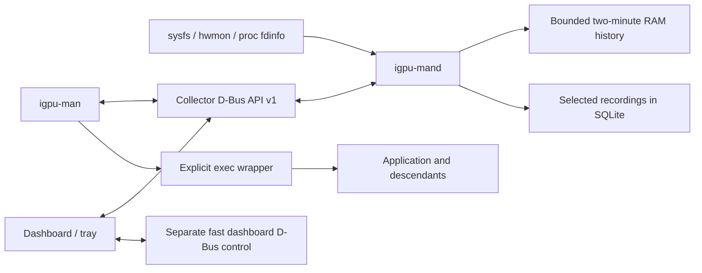

# Architecture

Sidecar (technical identity `igpu-man`) is an unprivileged, local Rust workspace for AMD GPUs on Plasma Wayland.
It observes placement and supports explicit launches; it does not move running
applications, tune clocks, change the compositor GPU, or guarantee gaming gains.

## Ownership and boundaries

| Component | Owns | Does not own |
| --- | --- | --- |
| `core` | Shared models, accounting, discovery, launch construction, config, SQLite, logging | UI widgets or privileged system configuration |
| `daemon` | Sampler, RAM ring, launch registry, recording state, saved profiles/exclusions | Desktop environment inherited by application launches |
| `cli` | Argument parsing, local requests, explicit exec and export/import commands | Automatic browser termination or shell evaluation |
| `desktop` | Views, chart history/scale, trial setup, tray and window lifecycle | Collector lifetime or automatic application migration |

The collector is the authoritative writer of configuration and recordings.
Configuration uses atomic replacement with private permissions. SQLite has one
collector owner enforced by a lock file, foreign keys, schema version checks and a
live-page budget. Selected recordings persist; ordinary monitoring stays in RAM.
A crash leaves recording rows that are marked interrupted on the next startup.

## Telemetry and identity

GPU identity is the PCI address. Render nodes and outputs are resolved at runtime.
Process identity is PID plus `/proc/PID/stat` start ticks. Shared DRM clients are
deduplicated, and registered descendants retain launch attribution after a wrapper
exits. A reused PID must never inherit the old application's placement evidence.

Metrics include source and availability. Device-open state, measured engine work,
and whole-device sensors are separate. Client memory may overlap, client engine
times are not additive device percentages, and absent decoder accounting does not
prove software decoding. Capability probes alone cannot verify playback.

The normal sampler runs at one second; recording defaults to 250 ms. Existing
descriptor lists are rediscovered every five seconds. The ring is bounded by age
and count. Candidate ranking uses measured, time-weighted recent activity; trials
require sustained identity-bound evidence. Chart auto-scale changes only axes.

## Threads and failure domains

- The sampler owns the live collector/configuration view behind a short mutex.
  It publishes immutable `Arc<Snapshot>` values into the two-minute ring. Live
  requests clone references under that lock, then compute/serialize outside it.
- A sleeping recording/configuration writer owns SQLite and processes a bounded
  128-entry FIFO. Sampling enqueues references without waiting for disk or parsing;
  eight queue slots are reserved from sample traffic for controls. Exhaustion fails
  visibly rather than silently dropping selected telemetry or growing RAM forever.
  Stop is ordered after all preceding samples and acknowledges after persistence.
  While draining, the snapshot reports the recording as stopping.
- Recording reads use query-only WAL connections with consistent read transactions.
  Two read jobs and eight mutation requests may be admitted; excess requests fail
  promptly as busy. Slow reads cannot occupy writer admission or the sampler lock.
  Statistics/export iterate samples, and exports buffer writes in 64 KiB chunks.
  Legacy materialized timeline/frame responses are capped at 64 MiB.
- Sampler, diagnostics and writer completion are supervised. Unexpected worker
  failure terminates visibly instead of serving an indefinitely stale snapshot.
- The dashboard's telemetry worker performs bounded blocking requests. Its
  lifecycle channel and separate D-Bus connection bypass that worker, so a slow
  or missing collector cannot block Close or Quit.
- A separate bounded recording worker handles detail/timeline/compare/import/export
  requests, including local file reads. Superseded detail responses are discarded
  by selection generation. Polling coalesces when its queue is occupied; it never
  prevents live telemetry refresh. These workers block/sleep when idle.
- A session-bus name permits one dashboard instance. Relaunches forward Show;
  simultaneous starts race for ownership without replacing a running instance.
- Close destroys the native window/renderer and parks the Rust dashboard model,
  tray and D-Bus owner in `resident.rs`. Eframe's cached on-demand event loop creates
  a fresh window on Activate/Show; contexts are detached/rebound, never hidden with
  unsupported Wayland visibility commands. Drafts/view state survive. Parked
  dashboard telemetry/catalog polling and rendering stop; explicit tray commands
  still work. No-tray Close exits, and watcher loss reopens a parked dashboard.
- Quit seals process shutdown immediately, including while parked. A desired-open
  state preserves Show during window teardown; a native close echo cannot overwrite
  that intent. No-tray shutdown seals atomically to avoid acknowledging a lost Show.
  Collector recording/workload lifetime remains independent.

The dashboard is reconstructible UI state. Saved profiles and recordings survive
its exit. The collector owns running trial specifications; Applications can resume
them with fresh verification, without automatically saving. Unlaunched editor
drafts remain ephemeral. An uncoordinated collector restart loses live launch registrations and trial evidence;
never fabricate a resumed verification result after that restart.

## Operational interfaces

The [API reference](api.md) covers both D-Bus interfaces. Public errors carry
context; collector requests include correlation IDs. Private structured JSON logs
provide lifecycle events, mutation outcomes, durations and bounded error causes.
[Troubleshooting](troubleshooting.md) describes safe collection and recovery.

WAL readers can retain old pages while a recording continues; the live-page budget
is not a hard bound on total disk use including WAL/free pages. Read scans have a
cooperative 20-second budget and the RPC deadline remains 30 seconds for large
operations. A stalled filesystem syscall is not forcibly cancelable. Read and queue
limits protect normal collection; they do not establish real-time disk guarantees.

## Remaining-review hardening

The dashboard view-model lives in `backend.rs`; recording work and worker-health
supervision have separate modules. Backend history, selected telemetry, frame
series and details are shared immutable values, so redraws do not copy full
recordings. The compact timeline skips process trees/raw CSV and prepares frame
peaks once. Raw paging and streaming exports retain complete data. Unexpected
worker exits are visible; Quit and relaunch creates fresh state. A poison race abandons
only that UI frame and switches to recovery without reading poisoned data;
unrelated panics retain fail-stop behavior. No automatic restart loop is added.

Configuration is the commit record for Keep. A versioned `pending_launcher`
intent is saved atomically with the profile. Publication uses an exclusive temporary
file and atomic no-clobber persist; resolved intents are cleared atomically.
Startup completes missing artifacts or recognizes matching ones. Conflicts remain
untouched with a warning, while the committed profile remains usable. This is
recoverable multi-file work, not filesystem-wide ACID; there is no periodic scan.

Unknown configuration/profile/specification fields are rejected before writes;
omitted known v1 fields retain defaults. Newer configurations require a compatible
build instead of being loaded then rewritten with unknown settings removed.
Typed operation names preserve the existing JSON/D-Bus boundary.

Builds embed a deterministic digest of Rust sources/Cargo manifests/lockfile,
compiler and target metadata. Logs identify source builds; explicit doctor and
release/install manifests add executable hashes. No Git metadata is required and
no recurring hash work is added to collection.

## Desktop identity

The user-facing name is Sidecar. Commands, storage, service/bus identifiers and
the `igpu-man.desktop` filename remain stable. The Wayland app ID matches that
desktop filename; the installed scalable icon resolves taskbar/launcher identity.
Window PNG and tray ARGB pixmaps are embedded and decoded once before workers
start. SNI carries its own pixels, so the tray works from an uninstalled checkout.
There is no runtime SVG renderer, asset polling or icon animation.

## Login startup

`--tray` constructs only the Rust model, sleeping workers and SNI service. No
eframe/winit event loop or GL context is created before Show/Activate. A bounded
15-second, event-driven grace handles late Plasma tray startup; a missing tray
opens a reachable fallback window. SNI service startup distinguishes a registered
watcher from a service waiting for one, using a synchronized initial handshake.
Duplicate `--tray` does not send Show or Close to an existing process.

Cold Quit drains outstanding dashboard D-Bus replies with a one-second bound;
otherwise the process could disappear before its accepted reply was sent.
Login setup is opt-in: an XDG autostart desktop entry launches `--tray`; the
independent systemd user collector is enabled separately. Templates use installed
paths; a checkout setup must use absolute paths and preserve existing config.

## Installation independence

Make accepts PREFIX and USER_UNIT_DIR. A build-time Python helper atomically
renders unit, desktop and autostart executable paths from that prefix; ordinary
runtime never reads the source tree. System installs use `/usr/lib/systemd/user`;
per-user installs use `~/.local/share/systemd/user`. Binaries, icon, license,
documentation and build manifest are copied, not symlinked to a checkout. XDG
user data remains outside the installed-file set. Higher-priority old config units
and launcher/autostart overrides must be migrated explicitly and backed up.

Developer deployment is an explicit build-time Python tool, not a runtime updater.
A writer-serialized maintenance lease prevents recording/profile mutations,
including requests queued before lease acquisition. A runtime unit override carries
the nonce through restart. Only matching-token launch restoration is admitted.
Atomic file transactions and private SQLite/config backups support rollback and
interrupted recovery; data is never replaced automatically during program rollback.

## Launch audit and idle work

Candidate launch-path projections reuse existing registration/descendant and
executable identities; they introduce no scanner, process-environment collection,
telemetry history or persistent tracking. Saved-profile matches are alternatives,
not launch-origin evidence. Actual registered intent takes precedence over other
profiles for that executable; ambiguous unregistered targets remain unspecified.
An unregistered launch cannot identify a shortcut/session restore or establish a
bypass after collector restart. Managed elsewhere suppresses routing suggestions.

The diagnostics worker owns a software-version cache outside the sampler lock.
Resolved executable metadata (device/inode/size/mtime) and the Arch package-database
directory invalidate it on the next 30-second check; a five-minute expiry covers
unobserved changes, including missing optional tools. Display/KWin queries keep
refreshing every 30 seconds. Hardware/connector discovery is unchanged to preserve
next-sample disconnect/reconnect detection. Parked telemetry blocks on its action
channel; attach/teardown sends an explicit visibility event, avoiding lost reopen
wake-ups. A bounded-counter diagnostic exposes wake-ups without per-tick logging.

## Async executor sizing

The collector's Tokio executor has two workers, independent of logical CPU count.
Sampling, diagnostics and response construction still use blocking workers;
SQLite/config mutations retain their separate ordered writer and read admission
stays bounded. The SNI thread drives a current-thread runtime continuously inside
block_on, including while the native window is parked. It needs no additional
CPU-sized scheduler pool. The control reply-drain runtime is also current-thread.

The zbus blocking API owns a separate dependency-managed executor, which is not
reconfigured here. Total OS thread count includes it, dedicated worker threads,
and on-demand Tokio blocking workers. No process-wide TOKIO_WORKER_THREADS
variable is set or passed to launched applications. Do not lower blocking-pool
capacity without checking sampler progress under simultaneous large reads; async
worker sizing is not a total concurrency cap.
